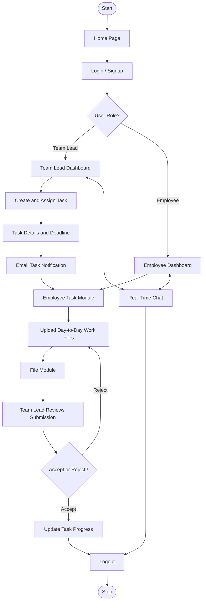

# A Unified Solution for Collaborative Project Management and Monitoring

A web-based project management and monitoring platform designed to help team leads and employees coordinate tasks, share work files, review submissions, track progress, and communicate through real-time chat.

## Overview

Traditional project workflows often rely on separate tools for task assignment, document sharing, progress updates, email communication, and team discussions.

This project brings these activities into one application with role-specific dashboards for **Team Leads** and **Employees**.

A team lead can create tasks, assign them to employees, set start and end dates, attach task documents, review submitted work, and monitor progress.

Employees can view their assigned tasks, upload day-to-day work files, follow task status, and communicate with their team lead through chat.

## Main Features

- **Role-Based User Accounts:** Separate signup and login flows for team leads and employees.
- **JWT Authentication:** Secure authentication using JSON Web Tokens.
- **Password Security:** Passwords are hashed using bcryptjs.
- **Task Management:** Create, assign, and manage tasks with deadlines.
- **Email Notifications:** Send task assignment details to employees through email.
- **File Upload and Sharing:** Upload and access task documents and employee submissions.
- **Submission Review:** Team leads can accept or reject submitted documents.
- **Progress Monitoring:** Track task completion through progress bars.
- **Real-Time Chat:** Communicate through Socket.IO.
- **Chat Attachments:** Share files through chat messages.
- **Profile Management:** View and update profile information.
- **Password Recovery:** OTP-based password recovery through email.

## User Roles and Workflow

### 1. Team Lead

- Register or log in as a Team Lead.
- Access the Team Lead Dashboard.
- Create tasks and modules.
- Assign tasks to employees using their email addresses.
- Set task start dates and deadlines.
- Upload task-related documents.
- Monitor employee submissions and task progress.
- Review uploaded documents.
- Accept or reject submitted work.
- Communicate with employees through real-time chat.

### 2. Employee

- Register using the team ID provided by the team lead or log in.
- Access the Employee Dashboard.
- View assigned tasks.
- Access task details through email notifications.
- Upload day-to-day work files.
- Track task progress and submission status.
- Communicate with the team lead through real-time chat.

## System Workflow

The following flowchart illustrates the overall workflow of the application.



## Technology Stack

| Component | Technology | Purpose |
|---|---|---|
| Frontend | React.js | User interface and dashboards |
| Styling | HTML, CSS, Styled Components | Responsive user interface |
| Backend | Node.js, Express.js | APIs and business logic |
| Database | MongoDB | Store application data |
| ODM | Mongoose | MongoDB data operations |
| Authentication | JWT | Secure user authentication |
| Password Hashing | bcryptjs | Password protection |
| Real-Time Communication | Socket.IO | Instant messaging |
| File Upload | Multer | Handle file uploads |
| Email Service | Nodemailer | Email notifications |
| HTTP Requests | Axios | Frontend-backend communication |
| Icons | React Icons | User interface icons |

## System Architecture

The application follows a client-server architecture with three major components.

### 1. Client Layer (Frontend)

- Developed using React.js.
- Provides separate dashboards for team leads and employees.
- Handles task creation, task management and file uploads.
- Provides real-time chat functionality.
- Communicates with the backend through REST APIs.

### 2. Server Layer (Backend)

- Developed using Node.js and Express.js.
- Handles authentication and authorization.
- Manages task creation and assignment.
- Processes file uploads and downloads.
- Handles email notifications.
- Supports real-time communication using Socket.IO.

### 3. Database Layer

- Uses MongoDB as the database.
- Stores user information, task details, submissions and messages.
- Uses Mongoose for database operations.

## Project Structure

### Frontend Structure

```text
frontend/
├── public/
└── src/
    ├── Assets/
    ├── ChatsComponents/
    ├── Components/
    ├── App.js
    ├── index.js
    └── sessionExpiry.js
```

### Backend Structure

```text
server/
├── controllers/
│   └── authControllers.js
├── middleware/
│   ├── authMiddleware.js
│   └── uploads.js
├── models/
│   ├── Data.js
│   ├── Message.js
│   ├── Task.js
│   └── User.js
├── routes/
│   ├── auth.js
│   ├── messageRoutes.js
│   └── task.js
├── util/
│   └── transporter.js
├── uploads/
├── db.js
├── server.js
├── package.json
└── .env
```

## Installation and Setup

### Prerequisites

Make sure you have installed:

- Node.js
- npm (Node Package Manager)
- MongoDB
- Visual Studio Code
- A web browser

### 1. Clone the Repository

```bash
git clone <YOUR_REPOSITORY_URL>
cd <REPOSITORY_FOLDER>
```

### 2. Backend Setup

Navigate to the server directory:

```bash
cd server
```

Install dependencies:

```bash
npm install
```

Create a `.env` file inside the server directory:

```env
PORT=5000
MONGODB_URI=mongodb://127.0.0.1:27017/collaborative_project_management
JWT_SECRET=your_secret_key
EMAIL_USER=your_email@example.com
EMAIL_PASS=your_email_app_password
```

Start the backend server:

```bash
npm run dev
```

Alternatively:

```bash
npm start
```

The backend runs on:

```text
http://localhost:5000
```

### 3. Frontend Setup

Open another terminal and navigate to the frontend directory:

```bash
cd frontend
```

Install dependencies:

```bash
npm install
```

Create a `.env` file inside the frontend directory:

```env
REACT_APP_URL=http://localhost:5000
```

Start the frontend:

```bash
npm start
```

The frontend normally runs on:

```text
http://localhost:3000
```

## API Endpoints

The following table provides an overview of the application's API endpoints.

### Authentication APIs

| Method | Endpoint | Description |
|---|---|---|
| POST | `/auth/signup` | Register a user |
| POST | `/auth/login` | Authenticate a user |

### Task Management APIs

| Method | Endpoint | Description |
|---|---|---|
| GET | `/api/tasks` | Retrieve tasks |
| POST | `/api/tasks` | Create a task |

### Chat APIs

| Method | Endpoint | Description |
|---|---|---|
| GET | `/api/messages/chat-list` | Retrieve chat list |
| GET | `/api/messages/messages/:userId` | Retrieve messages |
| POST | `/api/messages/send` | Send a message |

**Note:** Refer to the backend route files for the complete list of endpoints, HTTP methods and request parameters.

## Database Models

The application uses MongoDB with Mongoose to manage its data.

### 1. User Model

Stores user information such as:

- Name
- Email
- Password
- Role
- Profile information
- Team ID

### 2. Task Model

Stores:

- Task name
- Module details
- Assigned employee emails
- Start date
- End date
- Task document
- Submission details

### 3. Data Model

Stores uploaded employee submission information, including:

- Team ID
- Module ID
- Employee email
- Uploaded file path
- Submission status
- Review action

### 4. Message Model

Stores:

- Sender
- Receiver
- Message content
- Timestamp
- Read status
- Attachments
- Reactions

## Security Features

- JWT-based authentication.
- Password hashing using bcryptjs.
- Role-based access control.
- Protected API endpoints where authentication middleware is applied.
- Environment variables for sensitive configuration.
- File upload handling through Multer.

### Security Recommendation

Never upload the following to GitHub:

- `.env` files.
- MongoDB credentials.
- Email passwords or app passwords.
- JWT secrets.
- Private user information.
- Other sensitive configuration files.

Add appropriate entries to `.gitignore`:

```gitignore
node_modules/
.env
.env.*
uploads/
```

If real credentials have already been committed or pushed, rotate those credentials.

## Future Enhancements

The following features can be considered for future development:

- Mobile application support.
- Video calling and virtual meeting rooms.
- Calendar integration.
- Push notifications.
- Offline access.
- Advanced project analytics.
- Improved automated testing.
- CI/CD integration and deployment automation.

## Contributors

This project was developed by the following team members:

1. Masanam Sri Venugopala Sai
2. Tatineni Bhavya Sathya Priya
3. Venkata Krishna Lingala
4. Parasa Yugendhar

## Project Guide

**Mr. Y. Mastanaih Naidu, M.Tech**

Assistant Professor  
Department of Information Technology  
Bapatla Engineering College

## Academic Year

2024–2025

## License

No license has been specified for this project.
